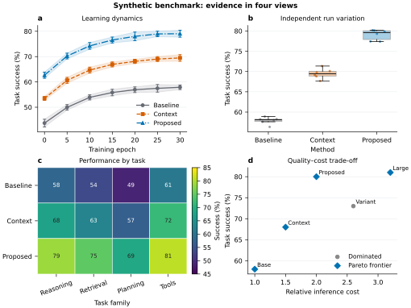
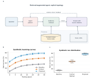
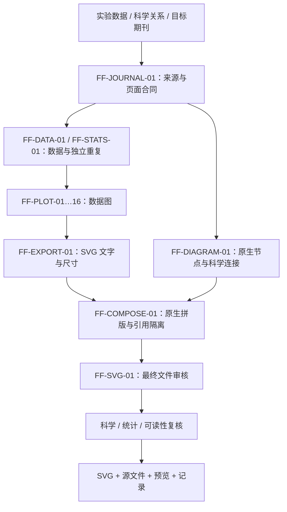

# FigureFoundry · 科研图铸

**把实验数据与科学关系，铸成有来源、可修改、可复现的论文图。**

FigureFoundry 是一个可安装的科研绘图 Skill，也是一套可独立运行的 Python/SVG
工具。它将前期筛选的 **16 个科研绘图 Skill 条目（12 个仓库）** 中有用的工作方法
整合为统一流程：核查期刊要求 → 理解实验与统计单位 → 绘图/示意 → 原生矢量拼版
→ 机械审核 → 实际成图复核 → 交付可编辑源文件。

核心约定是 **SVG 图形可编辑、文字仍是文字、定量图来自数据、默认无 AI 角标或平台
水印**。原生路径不依赖生成式图像 API；SVG 同时保留科学内容和可追溯记录。
“面向发表的制作流程”不等于保证论文录用或自动获得期刊认证。

[技能入口](skills/figurefoundry/SKILL.md) · [测试报告](docs/TEST_REPORT.md) ·
[冲突取舍](docs/CONFLICTS.md) · [全部来源](docs/SOURCES.md) · [扩展说明](docs/EXTENDING.md)

## 成图示例

下面使用随仓库提供的合成演示数据，**不是实验结论**。预览中的曲线、误差区间、
矩阵单元格、色条和文字均来自原生 SVG。下载 SVG 后可修改对象；改实验数值应从
数据与源规格重新生成。



[SVG 原图](examples/outputs/benchmark.svg) · [PNG 预览](examples/outputs/benchmark.png) ·
[生成规格](examples/benchmark.json) · [数据与统计记录](examples/outputs/benchmark.manifest.json)



[拼版 SVG](examples/outputs/composition.svg) · [拼版规格](examples/composition.json) ·
[审核记录](examples/outputs/composition.audit.json)

## 特点和能力

| 能力 | 实际提供什么 | 边界 |
|---|---|---|
| 实验数据输入 | CSV、TSV、JSON 行对象、JSONL、XLSX；字段/缺失检查、原文件 SHA-256 | 不造数据、不静默改值；旧 XLS 需可选 xlrd |
| 16 类原生科研图 | 折线、柱图、散点、箱线、小提琴、直方、ECDF、热图、混淆、相关矩阵、ROC、PR、森林、Pareto、堆叠柱、火山 | 自定义专业图有源码扩展路线；不是内置所有领域的分析模型 |
| 明确统计语义 | 均值/中位数、SD、SEM、Student-t CI95、Bootstrap95；记录 n 和重复单位 | 通用汇总不是配对检验、多层模型或自动因果推断 |
| 独立重复保护 | 对 subject/seed/run 等单位明确聚合；重复单位需显式 within_unit | 不把多次技术测量当作更多独立样本 |
| 阴性结果可绘制 | 零效应、低相关、随机/反向分类、全非显著火山图都保留 | 只拒绝类型、定义域或统计合同不成立的数据 |
| 原生可编辑 SVG | 保留 text/tspan 和图形对象；禁止 image 包裹整图或局部位图 | 字体仍需在实际编辑/渲染环境存在 |
| 固定物理尺寸 | mm 画布、最终字号、SVG/PDF/PNG 同源导出 | 不用 tight 裁切改变所声明的期刊尺寸 |
| 科学示意图 | 五种基础节点形状、语义色、资源分组、箭头、双向边、反馈及显式路径 | 拓扑由真实研究内容提供；复杂生物结构需专业知识/绘图源 |
| 多面板拼版 | 直接合并 SVG 子树；隔离 ID/样式/局部引用；保持比例并审核缩后字号 | 位图、复杂 CSS/foreignObject 等输入需先从源重建 |
| 整篇一致性 | 共享颜色角色、线型、标记、单位、图例、字号和版面规范 | 不将某种配色或四边框宣称为通用期刊标准 |
| 期刊工作流 | 按期刊、文章类型、阶段、官方 URL、核查日期建立 profile；检查完整性与冲突 | `journal` 命令不联网替人验证，不颁发合规证书 |
| 四层交付检查 | 科学含义、统计/来源、SVG 结构、最终尺寸的可读性 | 程序不能完全判断遮挡、科学解释或审美，仍需实际看图 |
| 可快速定位扩展 | 稳定 FF 能力编号、JSON 注册表、模块地图、对应文档和测试 | 新后端通过同一审核合同后才能升级为已验证能力 |

### 16 个原生图型

| 科学问题 | `kind` |
|---|---|
| 随时间/迭代的变化 | `line` |
| 分组中心与不确定性 | `bar` |
| 连续变量关系、显式 OLS | `scatter` |
| 分布与个体点 | `box`, `violin` |
| 频数/密度与累积分布 | `hist`, `ecdf` |
| 矩阵数值与分类错误 | `heatmap`, `confusion`, `correlation` |
| 二分类阈值行为 | `roc`, `pr` |
| 已计算效应与区间 | `forest` |
| 成本与效果的支配关系 | `pareto` |
| 非负组成/比例 | `stacked_bar` |
| 效应与 p/q 值关系 | `volcano` |

逐字段规范、输入实例、统计公式与限制见 [plot-spec.md](skills/figurefoundry/references/plot-spec.md)。
专业选图与自定义路线见 [chart-selection.md](skills/figurefoundry/references/chart-selection.md)。

## 安装和使用

### 作为 Skill

克隆本仓库，将 `skills/figurefoundry/` **整个文件夹**放入所用 Agent 支持的 Skills
目录，或使用该 Agent 的本地 Skill 导入功能。不要只复制 SKILL.md；它引用的脚本、
参考说明和能力注册表也是技能的一部分。具体目录由宿主应用规定；受管理环境若禁止
本地安装，可直接使用仓库脚本，不需要绕过目录权限。

技能调用名为 **`$figurefoundry`**，显示名为 **FigureFoundry · 科研图铸**。

```text
使用 $figurefoundry，根据我上传的实验表格和目标期刊要求绘图。
保留真实数据与统计单位，统一配色和图例。
交付可编辑文字与图形的 SVG 原图、源规格、预览和审核记录。
```

### 作为独立工具

需要 Python 3.11+；本次验证环境及精确版本记录在 [测试报告](docs/TEST_REPORT.md)
和 `requirements-tested.txt`。示意图、拼版和 SVG 审核仅使用 Python 标准库；数据图
使用 Matplotlib、NumPy、pandas、SciPy。依赖文件不安装任何图像生成服务。

```bash
git clone https://github.com/PresleyRen/figurefoundry-scientific-figures.git
cd figurefoundry-scientific-figures
python -m venv .venv
source .venv/bin/activate
python -m pip install -r requirements.txt
python skills/figurefoundry/scripts/figurefoundry.py doctor
```

Windows 激活虚拟环境时使用 `.venv\Scripts\activate`。命令使用 `python`；若系统
解释器叫 `python3`，按实际名称替换即可。已有项目可以继续使用自己的依赖环境。

### 用真实数据出图

准备 JSON 规格，指定数据列、图型、单位和页面尺寸。输入路径相对 **规格文件**，输出
路径相对 **当前工作目录**。以下示例均可在仓库根目录执行：

```bash
# 查看表格列、缺失值和来源哈希
python skills/figurefoundry/scripts/figurefoundry.py inspect examples/data/learning.csv

# 另存一份四面板图，默认生成 SVG、PDF、PNG、manifest.json
python skills/figurefoundry/scripts/figurefoundry.py plot --spec examples/benchmark.json --out build/benchmark

# 原生流程/机制图
python skills/figurefoundry/scripts/figurefoundry.py diagram --spec examples/diagram.json --out build/diagram.svg

# 拼接已生成的 SVG；示例 spec 使用 examples/outputs/ 下的面板
python skills/figurefoundry/scripts/figurefoundry.py compose --spec examples/composition.json --out build/composite.svg

# 最终 SVG 结构/字号/尺寸检查
python skills/figurefoundry/scripts/figurefoundry.py audit build/benchmark.svg --min-font-pt 6 --width-mm 180 --height-mm 135

# 审核期刊 profile 的记录是否完整；这是规划例子，不会得到期刊认证
python skills/figurefoundry/scripts/figurefoundry.py journal --profile examples/journal-profile.json

# 按关键词找到能力、代码、说明和测试
python skills/figurefoundry/scripts/figurefoundry.py capabilities --query heatmap
```

命令默认拒绝覆盖已有输出。明确要更新时使用 `--overwrite`。审核不通过退出码为 2，
返回具体原因；没有通过的文件不可描述为符合严格 SVG 约定。

重建随仓库发布的合成示例：

```bash
python examples/generate_examples.py
```

该脚本会明确替换 `examples/data/` 和 `examples/outputs/` 的演示文件，使用固定
随机种子 1729。它不会读取或发布用户实验文件。示例图注见 [examples/README.md](examples/README.md)。

## SVG 的“可编辑”具体指什么

**数据可以从源文件重算；绘图代码和 JSON 可以修改；SVG 中的几何对象可以修改；
标签仍可直接修改文字。** 这四项分别保留，不能拿“矢量可缩放”代替“文字可编辑”。

导出器显式设置 `svg.fonttype=none`，不允许现存 usetex 或 rasterized 图层。热图使用
非栅格网格，色条也单独保持矢量；PNG 仅用于预览。最终审核读取实际 XML，检查文字
清单、位图数量、物理尺寸、变换后的字号、ID 与引用，而非只检查文件后缀。

图中不会自动添加 AI 标识或平台水印。数据本身的 “AI/ML” 字样、科学标签和必要来源
不会被关键词误删；工具与数据来源保存在 manifest。期刊确实要求的工具使用披露按其
要求放在正文/图注等位置，不靠删除图件来源记录来规避。

静态审核有边界：它不能确保全部字体都已安装，不能完全检测文字遮挡/裁切，也不能
鉴别任意路径是不是某个字。对已知标签要提供完整预期清单，并使用真实 SVG 渲染器
检查成图。详细约定见 [svg-contract.md](skills/figurefoundry/references/svg-contract.md)。

## 来源如何合并，冲突如何选择

没有直接拼贴互相矛盾的 SKILL.md。整合采用统一合同、独立实现、来源编号和可复跑
反例。全部 16 项的固定 commit、许可正文、保留能力与排除理由在 [SOURCES.md](docs/SOURCES.md)。

| 来源组 | 保留的有用能力 |
|---|---|
| K-Dense 的 scientific-visualization / matplotlib / seaborn / venue-templates / scientific-schematics | 数据与误差规范、绘图控制、长表/分面思路、当前期刊定位、关系先行的示意设计 |
| nature-figure、sci-figure、science-plotting | Figure Contract、整篇一致性、中英文调图、表格驱动、统计与源码交付 |
| academic-figures、Scientific-Figure-Design | 原生 SVG、命名分组、布局变体、语义色、架构反馈与专业来源路线 |
| academic-figure-skill、tikz-scientific-figures | 丰富的选图知识、分层 QA、专业数学/电路/TikZ 源路由 |
| scientific-visualization、scientific-plotting、sci-paper-plot-skill、FigureCraft | 风格比较、可追溯交付、工程调图术语、实体与关系约束、局部修改与审阅 |

| 冲突 | 本项目保留的方案 | 验证方式 |
|---|---|---|
| 文字转曲 vs text/tspan | 保留文字；几何曲线正常用 path | 真实导出 A/B 与预期标签检查 |
| imshow/PNG 拼装 vs 原生矢量 | 网格单元、矢量色条、SVG 子树拼版 | image 反例、组合后引用与字号检查 |
| tight bbox vs 精确尺寸 | 固定毫米画布 | 读取实际 width/height，比较裁切反例 |
| “结果够显著才给画” | 合法阴性结果照常显示 | 零效应、AUC=0/0.5、全非显著火山图 |
| 自动误差棒 vs 独立重复 | 明确单位、误差定义与样本量 | 手算 tCI、技术重复不增独立 n |
| 固定期刊预设 vs 当前要求 | profile 记录官方来源与阶段 | 缺失/过期/冲突记录检查与人工官方核对 |
| 统一强制审美 vs 图型适配 | 有依据的配色、线型和边框选择 | 保持数值不变，实际渲染检查 |

完整 **CF-01–CF-16** 决策与证据边界见 [CONFLICTS.md](docs/CONFLICTS.md)。机械测试、
独立试用与视觉审阅的实际执行结果分别列在 [TEST_REPORT.md](docs/TEST_REPORT.md)，
没有把“读过上游代码”写成“运行过全部上游项目”。

## 文本结构图：快速定位与未来扩展

以下是可直接编辑的 Mermaid 文本图；GitHub 会将它渲染为结构图。稳定 FF 编号在
[capabilities.json](skills/figurefoundry/assets/capabilities.json) 中映射到模块、说明和测试。



| 要调整的能力 | 首选位置 | 关联验证 |
|---|---|---|
| 技能触发、路由、交付规范 | [SKILL.md](skills/figurefoundry/SKILL.md) | 独立任务试用与包校验 |
| 读表、单位、统计汇总 | [ff_data.py](skills/figurefoundry/scripts/ff_data.py) | test_plot_engine / test_cli_and_data |
| 新图型或图形样式 | [ff_plots.py](skills/figurefoundry/scripts/ff_plots.py) | 已知数值、阴性结果、SVG 输出 |
| 导出、尺寸、文件与 manifest | [ff_export.py](skills/figurefoundry/scripts/ff_export.py) | test_conflicts |
| SVG 文字/尺寸/安全结构 | [ff_svg.py](skills/figurefoundry/scripts/ff_svg.py) | test_svg_audit |
| 节点、箭头、语义图 | [ff_diagram.py](skills/figurefoundry/scripts/ff_diagram.py) | test_diagrams |
| 多图组合、ID/CSS 隔离 | [ff_compose.py](skills/figurefoundry/scripts/ff_compose.py) | test_diagrams |
| 期刊记录与当前要求 | [ff_journal.py](skills/figurefoundry/scripts/ff_journal.py)、[工作流](skills/figurefoundry/references/journal-workflow.md) | test_cli_and_data + 官方复核 |
| R/TikZ/Draw.io/Plotly | [optional-backends.md](skills/figurefoundry/references/optional-backends.md) | 当前为可选指导，不是全部实测后端 |

新增能力按“注册 FF 编号 → 实现/参考页 → 最小输入 → 数值与反例测试 → SVG/视觉验证
→ 更新报告”的顺序完成。具体流程见 [EXTENDING.md](docs/EXTENDING.md)。

## 测试、兼容性和许可

```bash
python tools/check_package.py
python -m unittest discover -s tests -v
python tools/run_checks.py --report docs/test-results.json
```

仓库包含数值/统计行为测试、真实 SVG 导出对照、恶意或无效 SVG 反例、原生拼版
测试、CLI/数据输入测试，以及单独执行的示例与独立任务试用记录。CI 自动运行包检查
和 unittest；视觉质量与科学含义不冒充自动评分。

R/svglite、TikZ/dvisvgm、Plotly/Kaleido 和 Draw.io 的完整外部工作流仍为可选路线，
本版本没有声称全部端到端验证。显微照片、凝胶照片等原始测量图像天然是像素数据，
不能通过改后缀变成可逐对象编辑的纯矢量实验内容；应保留测量原图并按独立图像流程
处理，不能为了“纯 SVG”伪造其结构。

原创代码与文档使用 [MIT License](LICENSE)。上游来源与依赖的独立许可见
[THIRD_PARTY_NOTICES.md](THIRD_PARTY_NOTICES.md)。未复制许可不明仓库的代码、
图标/模板集合、图像生成服务或外部编辑器。
