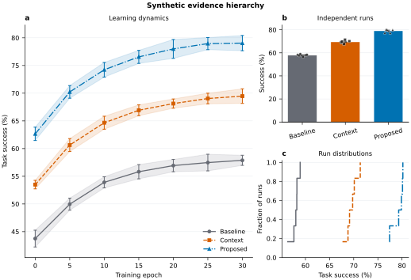
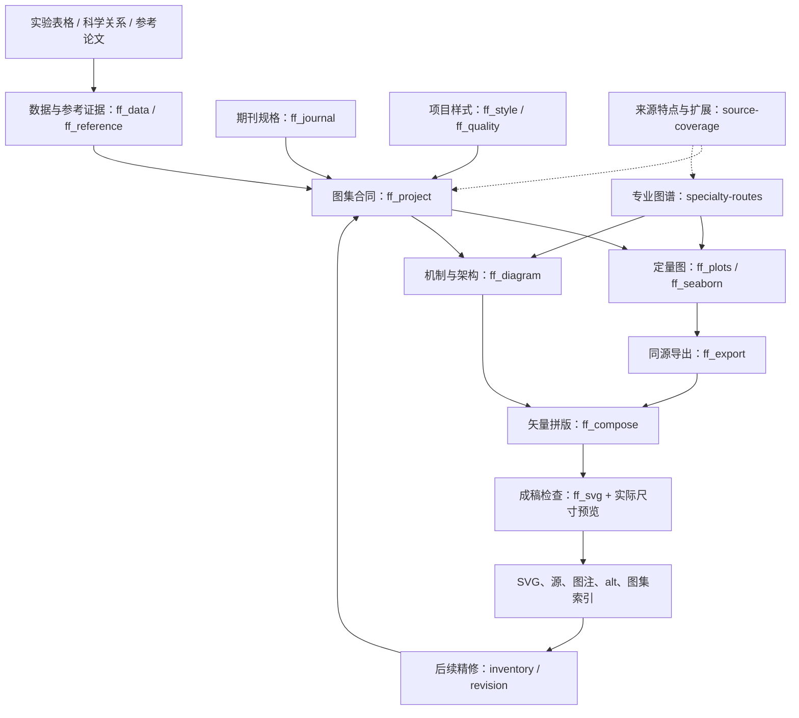

# FigureFoundry · 科研图铸

**从实验数据到论文图集：期刊规格、科学表达、可编辑 SVG 和可复现源，一套流程完成。**

FigureFoundry 是一个科研绘图 Skill，也是一套可独立运行的 Python/SVG 工具。它将 **16 个科研绘图技能、12 个仓库**的有用特点归入统一的绘图、排版、审阅和交接流程。当前索引包含 **103 个来源特点、41 个能力入口和 26 条专业路线**；每项来源特点都能追到实现、参考说明、互补能力和测试文件。

生成的原图保留 **可编辑图形 + 可直接修改的文字**，不叠加 AI 角标、平台标志或品牌水印。实验数值来自输入数据，样式由项目配置控制；数据图的同一份源可重建 SVG、PDF、PNG 和来源记录。

[技能入口](skills/figurefoundry/SKILL.md) · [逐特点覆盖表](docs/COVERAGE.md) · [全部来源](docs/SOURCES.md) · [测试结果](docs/TEST_REPORT.md) · [扩展指南](docs/EXTENDING.md)

## 看看成图效果

以下图件使用仓库附带的 **Synthetic 合成演示数据**。SVG 中的曲线、点、误差条、矩阵单元、色条和文字均可继续编辑。


[查看 SVG 原图](examples/outputs/benchmark.svg) · [绘图配置](examples/benchmark.json) · [数据与统计记录](examples/outputs/benchmark.manifest.json)



[非对称版式 SVG](examples/outputs/asymmetric.svg) · [跨行跨列配置](examples/asymmetric.json) · [机制图与数据图拼版](examples/outputs/composition.svg)

## 能力总览：能做什么，会得到什么

| 能力 | 作用和效果 | 使用入口 |
|---|---|---|
| 实验表格读取 | 读取 CSV、TSV、JSON、JSONL、XLSX；检查字段、缺失值与原文件哈希 | `inspect`；`FF-DATA-01` |
| 长表与宽表多曲线 | 显式选择测量列，保留主体 ID、时间、分组和缺失位置 | `kind: "line"` + `y_columns`；`FF-PLOT-01` |
| 独立重复与误差 | 均值/中位数、SD、SEM、Student-t 95% CI、Bootstrap；记录独立 n 和组内归约 | `unit` / `within_unit`；`FF-STATS-01` |
| 16 类数据图 | 覆盖趋势、比较、分布、矩阵、分类性能、效应、组成和成本 | `plot`；`FF-PLOT-01…16` |
| 原始点与拟合 | 柱图叠独立单位点；OLS 方程与 R²；正态/对数正态密度拟合 | `raw_points` / `fit` / `fit_annotation`；[参数说明](skills/figurefoundry/references/plot-spec.md) |
| 明确的颜色数值映射 | 线性、对数、中心发散、对称对数、分段色阶；多图共享同值同色 | `norm`；热图/混淆/相关矩阵 |
| 非对称多面板 | 主结果跨行跨列，支持面板按证据层级排布；行列比例可调 | `panel.grid`；`FF-LAYOUT-01` |
| 科学机制与架构图 | 节点、分组、箭头、反馈、显式连线路径与中英文标签 | `diagram`；`FF-DIAGRAM-01` |
| 原生 SVG 拼版 | 合并子图图元，保持比例，隔离 ID 和引用，并检查组合后的文字 | `compose`；`FF-COMPOSE-01` |
| 五类样式与全论文一致性 | minimal、engineering、classic、warm、compact；共享颜色、点形、线型、字号与图例 | `plot-defaults.json`；`FF-STYLE-01/02` |
| 配色和灰度检查 | 文字/背景对比度、相对亮度、CIE L*、组间明度差与冗余编码 | `palette`；`FF-QUALITY-01` |
| 图集合同和候选选择 | 记录每图的问题、证据角色、数据、科学量、实体关系、版式候选和选中版本 | `project`；`FF-PROJECT-01` |
| 主源交接与精修比较 | 精修后指向实际可编辑源；冻结旧源；比较样式修改与指定文字修改 | `project` / `revision`；`FF-REVISION-01` |
| 图注与替代文本 | 输出图集索引、图注、alt text；可把标题和长描述写入 SVG | `project` / `annotate`；`FF-ACCESS-01` |
| 参考论文图件整理 | 从本地论文 HTML 提取图、子图、图注、alt、资产 URL、邻近正文和来源哈希 | `references`；`FF-REFERENCE-01` |
| 文献 benchmark 来源 | 记录 DOI/URL、图表号、读图方法、单位、变换及不确定性 | `benchmark-source`；`FF-REFERENCE-02` |
| 已有脚本精确美化 | 定位 Python/Notebook 中的布局、字体/图例和导出调用，给出文件、行号与代码单元 | `inventory`；`FF-INVENTORY-01` |
| Seaborn 高级图 | FacetGrid、PairGrid、JointGrid、clustermap 四种可执行配方；另提供显式权重均值 | `ff_seaborn.py`；`FF-CUSTOM-02` |
| 中英专业图谱 | 从实验问题找到生存、雨云、富集、组学、动力学、场图、电路、化学、硬件等路线 | `atlas`；`FF-ATLAS-01` |
| 既有项目后端接入 | 沿用 Matplotlib、R/ggplot2、TikZ、Draw.io、Plotly 源，并接入同一 SVG 审核与交接 | `FF-CUSTOM-01` / `FF-OPTION-*`；[后端手册](skills/figurefoundry/references/optional-backends.md) |
| 期刊图件准备 | 按期刊、文章类型、投稿阶段、官方来源与核验日期组织尺寸、字体和交稿格式 | `journal`；`FF-JOURNAL-01` |
| 固定尺寸与可编辑导出 | 保留毫米画布、真实文字与矢量几何；数据图另生成来源 manifest 和同源 PDF/PNG | `FF-EXPORT-01` / `FF-SVG-01` |
| 逐特点检索与扩展 | 从来源技能、能力编号或专业关键词找到实现、说明、互补关系和修改位置 | `coverage` / `capabilities` / `atlas`；`FF-COVERAGE-01` |

### 16 类原生图型

| 实验问题 | `kind` | 可用效果 |
|---|---|---|
| 时间、剂量、迭代与学习过程 | `line` | 长表/宽表多曲线、分组、误差区间、稀疏点形、缺失段 |
| 组别中心及重复差异 | `bar` | 分组柱、SD/SEM/CI、独立单位点叠加 |
| 两个连续量的关系 | `scatter` | 原始点、显式 OLS、方程和 R² |
| 组内分布和个体差异 | `box`, `violin` | 分布轮廓与原始点 |
| 频数、密度和累积概率 | `hist`, `ecdf` | 共同分箱、可选分布拟合、经验累积分布 |
| 矩阵数值、分类混淆和相关 | `heatmap`, `confusion`, `correlation` | 原生网格、数值标注、矢量色条、多种 norm |
| 二分类阈值性能 | `roc`, `pr` | 阈值曲线、AUC/AP、正确处理并列分数 |
| 已有的效应量与区间 | `forest` | 区间、参考线、效应标签 |
| 质量与成本的关系 | `pareto` | 非支配前沿、方向选择、方法标签 |
| 非负组成与比例 | `stacked_bar` | 堆叠组成、显式比例化 |
| 效应与 p/q 值 | `volcano` | 效应阈值、统计阈值与完整阴性结果 |

完整字段、输入样例、统计定义和实际效果见 [绘图规格](skills/figurefoundry/references/plot-spec.md)。专业任务可查看 [中英专业图谱](skills/figurefoundry/references/specialty-atlas.md) 和 [科学选图说明](skills/figurefoundry/references/chart-selection.md)。

### 26 条专业任务路线

| 专业方向 | 解决的实验表达问题 | 路线说明 |
|---|---|---|
| [生存与删失](skills/figurefoundry/references/specialty-atlas.md#sp-survival) | 处理组的事件发生时间和随访风险如何变化？ | 专业源码 / 既有后端接入 |
| [雨云、山脊与密度分布](skills/figurefoundry/references/specialty-atlas.md#sp-raincloud) | 各组完整分布、典型范围和实际重复点有什么异同？ | 专业源码 / 既有后端接入 |
| [富集、GSEA 与通路](skills/figurefoundry/references/specialty-atlas.md#sp-enrichment) | 哪些预先定义的功能集或通路与已完成的分析结果关联？ | 专业源码 / 既有后端接入 |
| [Manhattan、QQ 与 MA](skills/figurefoundry/references/specialty-atlas.md#sp-gwas) | 基因组位置或平均表达如何对应已计算的关联/差异统计量？ | 专业源码 / 既有后端接入 |
| [PCA、RDA、UMAP 与轨迹](skills/figurefoundry/references/specialty-atlas.md#sp-embedding) | 样本结构、已计算的嵌入或沿定义轨迹的状态如何分布？ | 专业源码 / 既有后端接入 |
| [标记基因、表达和单细胞摘要](skills/figurefoundry/references/specialty-atlas.md#sp-expression) | 不同细胞群或条件的表达强度和检测比例如何比较？ | 专业源码 / 既有后端接入 |
| [聚类、多注释、密度与三维热图](skills/figurefoundry/references/specialty-atlas.md#sp-heatmap) | 矩阵模式、样本聚类或分布摘要如何对应实验分组和注释？ | 专业源码 / 既有后端接入 |
| [集合交集、Sankey 与网络流](skills/figurefoundry/references/specialty-atlas.md#sp-set-flow) | 集合重叠、状态流量或明确网络关系怎样组织？ | 专业源码 / 既有后端接入 |
| [相关、Mantel、边际与成对探索](skills/figurefoundry/references/specialty-atlas.md#sp-correlation) | 变量关系、距离矩阵关联或拟合残差中有什么结构？ | 专业源码 / 既有后端接入 |
| [配对、变化量与 superplot](skills/figurefoundry/references/specialty-atlas.md#sp-paired) | 同一实验单位前后怎样变化，或两种测量方法是否一致？ | 专业源码 / 既有后端接入 |
| [模型评估、消融与解释](skills/figurefoundry/references/specialty-atlas.md#sp-model-eval) | 方法性能、阈值取舍、概率校准或组成模块的贡献如何比较？ | 专业源码 / 既有后端接入 |
| [时域响应、验证与局部放大](skills/figurefoundry/references/specialty-atlas.md#sp-time-response) | 实验、仿真或不同方法的响应和局部偏差如何随时间变化？ | 专业源码 / 既有后端接入 |
| [频谱、功率谱与频响](skills/figurefoundry/references/specialty-atlas.md#sp-spectrum-frf) | 信号频率成分、功率分布或输入到输出的频率响应如何变化？ | 专业源码 / 既有后端接入 |
| [时频、频率热图与参数场](skills/figurefoundry/references/specialty-atlas.md#sp-time-frequency) | 频率能量或响应模式怎样随时间或扫描参数改变？ | 专业源码 / 既有后端接入 |
| [相图与 Poincaré 截面](skills/figurefoundry/references/specialty-atlas.md#sp-phase-poincare) | 系统状态轨迹和按明确定义截面采样后的结构是什么？ | 专业源码 / 既有后端接入 |
| [分岔与吸引域](skills/figurefoundry/references/specialty-atlas.md#sp-bifurcation-basin) | 参数或初值如何对应稳定状态、周期变化和吸引子类别？ | 专业源码 / 既有后端接入 |
| [向量场、等高线与三维表面](skills/figurefoundry/references/specialty-atlas.md#sp-field-surface) | 空间或参数场中的幅度、方向和表面形态怎样关联？ | 专业源码 / 既有后端接入 |
| [电路与信号连接](skills/figurefoundry/references/specialty-atlas.md#sp-circuit) | 电路元件、节点、电源及信号路径如何连接？ | 专业源码 / 既有后端接入 |
| [受力、机构与几何](skills/figurefoundry/references/specialty-atlas.md#sp-force-geometry) | 对象几何、坐标、约束和作用力如何对应模型？ | 专业源码 / 既有后端接入 |
| [分子、反应、能垒与晶格](skills/figurefoundry/references/specialty-atlas.md#sp-chemistry) | 结构、反应关系或已计算能量路径如何表达？ | 专业源码 / 既有后端接入 |
| [细胞、通路、基因与质粒](skills/figurefoundry/references/specialty-atlas.md#sp-biology) | 生物对象的组成、方向、定位和证据支持的相互作用是什么？ | 专业源码 / 既有后端接入 |
| [硬件层次、阵列、层叠与局部放大](skills/figurefoundry/references/specialty-atlas.md#sp-hardware) | 器件组成、层次归属、阵列计数与局部结构怎样对应？ | 专业源码 / 既有后端接入 |
| [系统、自动机、树图与数学关系](skills/figurefoundry/references/specialty-atlas.md#sp-cs-math) | 计算对象的层次、状态变化、类型关系或数学映射是什么？ | 专业源码 / 既有后端接入 |
| [光路、场论与物理示意](skills/figurefoundry/references/specialty-atlas.md#sp-physics) | 射线、光学元件、粒子关系或物理过程如何按领域符号呈现？ | 专业源码 / 既有后端接入 |
| [非对称多面板、摘要和方法主图](skills/figurefoundry/references/specialty-atlas.md#sp-layout) | 哪些面板共同回答同一问题，主叙事和辅助证据如何分配？ | 专业源码 / 既有后端接入 |
| [CONSORT / PRISMA 分支计数](skills/figurefoundry/references/specialty-atlas.md#sp-reporting-flow) | 流程阶段的数量、排除原因和单位如何对应？ | 图件合同 + 计数核对 + 原生节点 |

每条路线都列出所需字段、单位、接入步骤和可复用能力编号，便于从专业术语直接找到具体实现位置。

## 16 个来源怎样互相补齐

| 来源 | 保留的主要特点 | 在 FigureFoundry 中如何互补 |
|---|---|---|
| S01 · K-Dense scientific-visualization | 数据与误差、固定尺寸、颜色/灰度、可复现交付 | 为排版和美化提供统计、配色测量与 SVG 共同出口 |
| S02 · K-Dense matplotlib | Figure/Axes 控制、注释、GridSpec、专业图拓展 | 为主面板布局和定量图提供实际绘制能力 |
| S03 · K-Dense seaborn | 表格语义、分面、多变量关系、聚类与分布 | 用四类可运行配方扩展原生图，沿用同一文字和色条审核 |
| S04 · K-Dense venue-templates | 按文章类型和阶段查规范，记录来源与冲突 | 把期刊要求落实到物理尺寸、字体、文件与图集交接 |
| S05 · K-Dense scientific-schematics | 先理清对象和关系，再布局、审阅、迭代 | 用原生节点和关系图实现示意；结合实体/数量合同 |
| S06 · nature-figure | 图件合同、主结果层级、全论文语义样式 | 连接跨行跨列版式、共享样式文件与独立图集 |
| S07 · sci-figure | 全框坐标、整合式面板标题、列宽字号 | 转为可选、可验证的样式和字体角色设置 |
| S08 · science-plotting | 宽表多曲线、原始点、OLS 标注、分布拟合 | 补齐常见实验表格到成图的直接操作 |
| S09 · academic-figures | 叙事结构、布局/风格候选、图形摘要、原生分组 | 与科学量锁定、同尺寸比较和选定版本记录连接 |
| S10 · Scientific-Figure-Design | 参考图语料、视觉语言、Agent 更新语义、论文配色 | 加入 HTML 证据清单、参考图审阅与共享角色检查 |
| S11 · academic-figure-skill | 实验问题选图、专业图谱、多角度成图审阅 | 提供中英关键词路线，结合真实数据、SVG 和视觉核验 |
| S12 · tikz-scientific-figures | 参数化几何、专业符号、源码和手工 SVG 交接 | 保存既有 TikZ 源；统一选中源与冻结源的版本关系 |
| S13 · scientific-visualization | 多风格、样式叠加、分面与多格式 | 用五类具名样式和真实导出测试保持外观与内容一致 |
| S14 · scientific-plotting | 数据/脚本/图/说明配套、文献读图、同风格批量图 | 补上 benchmark 来源结构和可索引的项目图集 |
| S15 · sci-paper-plot-skill | 项目默认值、中英调图、已有脚本美化、参数定位 | 加入默认值合并、源码 inventory 与精修比较 |
| S16 · FigureCraft | 实体/层次/数量、整体局部、语义改色、版本交接 | 把科学内容、视觉候选和最终可编辑源连成同一合同 |

**逐个特点的完整对应表**在 [COVERAGE.md](docs/COVERAGE.md)：每项有 `Sxx-Fxx` 编号、能力入口、实现、说明、测试与扩展位置。[SOURCES.md](docs/SOURCES.md) 保存固定提交与来源链接；[CONFLICTS.md](docs/CONFLICTS.md) 保存比较条件、实际结果和采用方案。

## 快速开始

### 作为 Skill 使用

把仓库中的 `skills/figurefoundry/` **整个文件夹**导入所用 Agent 的 Skills 目录。调用名是 **`$figurefoundry`**，显示名为 **FigureFoundry · 科研图铸**。

```text
使用 $figurefoundry，根据上传的实验数据和目标期刊制作科研图。
先确定每张图回答的问题、独立实验单位和误差定义。
整篇统一颜色、点形、线型和字号，为主图比较两套合理版式。
交付可编辑图形与文字的 SVG、源文件、图注、替代文本和图集索引。
记录选定版本与可继续修改的主源。
```

### 作为独立工具使用

Python 3.11+。数据图使用 Matplotlib、NumPy、pandas、SciPy；图件索引、原生示意、拼版和 SVG 审核使用 Python 标准库。Seaborn 配方单独使用 Seaborn。

```bash
git clone https://github.com/PresleyRen/figurefoundry-scientific-figures.git
cd figurefoundry-scientific-figures
python -m venv .venv
source .venv/bin/activate
python -m pip install -r requirements.txt
python skills/figurefoundry/scripts/figurefoundry.py doctor
```

Windows 激活命令为 `.venv\Scripts\activate`。重建完整测试环境时使用 [requirements-tested.txt](requirements-tested.txt)。

### 从表格到图件

```bash
python skills/figurefoundry/scripts/figurefoundry.py inspect examples/data/learning.csv
python skills/figurefoundry/scripts/figurefoundry.py plot --spec examples/benchmark.json --out build/benchmark
python skills/figurefoundry/scripts/figurefoundry.py plot --spec examples/asymmetric.json --out build/asymmetric
python skills/figurefoundry/scripts/figurefoundry.py diagram --spec examples/diagram.json --out build/diagram.svg
python skills/figurefoundry/scripts/figurefoundry.py compose --spec examples/composition.json --out build/composite.svg
python skills/figurefoundry/scripts/figurefoundry.py audit build/asymmetric.svg --min-font-pt 6 --width-mm 183 --height-mm 125
python skills/figurefoundry/scripts/figurefoundry.py journal --profile examples/journal-profile.json
```

输入数据路径相对图件 JSON；输出路径相对当前工作目录。数据图默认生成 `.svg`、`.pdf`、`.png`、`.manifest.json`。修订可另存新文件；明确更新同一输出时加 `--overwrite`。

### 一套论文图共享样式

在每张图的 JSON 中写 `"defaults": "plot-defaults.json"`，公共配置如下：

```json
{
  "version": 1,
  "theme": "engineering",
  "figure": {"axis_font_pt": 8, "tick_font_pt": 7, "min_font_pt": 6},
  "palette": {
    "Baseline": {"color": "#666A73", "marker": "o", "linestyle": "--"},
    "Proposed": {"color": "#0072B2", "marker": "s", "linestyle": "-"}
  },
  "panel_defaults": {"linewidth": 1.2, "markersize": 3}
}
```

当前图和面板的显式参数优先于项目默认值。主结果可设 `"grid": [0, 0, 2, 1]` 跨两行；其他面板使用剩余位置。方法出现顺序变化时，颜色、点形和线型保持原有含义。

完整图集合同、候选选择、图注、alt text 和主源交接见 [project-workflow.md](skills/figurefoundry/references/project-workflow.md)。

```bash
python skills/figurefoundry/scripts/figurefoundry.py project --spec project.json --out build/project-index.json --notes-dir build/notes
python skills/figurefoundry/scripts/figurefoundry.py project --spec project-v2.json --baseline build/project-index.json --out build/project-index-v2.json
python skills/figurefoundry/scripts/figurefoundry.py revision original.svg polished.svg
python skills/figurefoundry/scripts/figurefoundry.py inventory analysis.py notebook.ipynb
```

### 参考图、配色与高级分面

```bash
python skills/figurefoundry/scripts/figurefoundry.py references --html paper.html --source-url https://example.org/paper --out build/reference-figures.json
python skills/figurefoundry/scripts/figurefoundry.py benchmark-source --record literature-benchmark.json
python skills/figurefoundry/scripts/figurefoundry.py palette --spec palette.json
python skills/figurefoundry/scripts/figurefoundry.py annotate figure.svg --title "Dose response" --description "Description based on the actual experiment." --out figure-described.svg
python skills/figurefoundry/scripts/ff_seaborn.py --synthetic-demo --out build/seaborn
```

参考证据格式见 [reference-intake.md](skills/figurefoundry/references/reference-intake.md)；配色、替代文本、编辑比较和 Seaborn 输入约定见 [quality-workflow.md](skills/figurefoundry/references/quality-workflow.md)。

## 明确的文本结构图

下面的 Mermaid 图直接由文本维护，GitHub 会渲染成结构图。节点名称与模块和命令对应，FF 能力编号可从上方能力表及索引查询。



## 以后有不足，怎样快速找到并补齐

三个检索入口各有用途：`coverage` 查某个来源的具体特点，`capabilities` 查已注册功能，`atlas` 按专业任务找数据要求与实现路线。

```bash
python skills/figurefoundry/scripts/figurefoundry.py coverage --source S08
python skills/figurefoundry/scripts/figurefoundry.py coverage --query 主源
python skills/figurefoundry/scripts/figurefoundry.py capabilities --query 灰度
python skills/figurefoundry/scripts/figurefoundry.py atlas --query 富集图
python skills/figurefoundry/scripts/figurefoundry.py atlas --query 相图
```

| 遇到的问题或想增加的效果 | 优先定位 | 怎样补齐 | 对应测试 |
|---|---|---|---|
| 新表格格式、宽表或重复测量 | `ff_data.py` | 增加显式转换或统计单位规则 | `test_cli_and_data.py`、`test_plot_feature_coverage.py` |
| 新图种、拟合或矩阵颜色映射 | `ff_plots.py` | 新增处理器或参数，记录数值与变换 | `test_plot_engine.py`、`test_plot_feature_coverage.py` |
| 版式层级不清、主图空间不足 | `ff_plots.py` / `ff_compose.py` | 修改 grid、比例或面板位置 | `test_plot_feature_coverage.py`、`test_reaudit_conflicts.py` |
| 整篇方法颜色/点线不一致 | `ff_style.py`、共享 palette | 定义完整角色样式并固定项目配置 | `test_style_inventory.py`、`test_workflow_features.py` |
| 灰度难分或文字对比不足 | `ff_quality.py` | 补明度、对比度或冗余编码 | `test_workflow_features.py` |
| 新的科学对象、连接或局部图 | `ff_diagram.py` / `ff_project.py` | 增加图元、实体关系与数量字段 | `test_diagrams.py`、`test_workflow_features.py` |
| 精修后旧源覆盖了新图 | `ff_project.py` | 更新 selected_variant、active source 和冻结关系 | `test_workflow_features.py` |
| 找不到脚本中真正生效的参数 | `ff_inventory.py` | 增加需要定位的调用名称或源码类型 | `test_style_inventory.py` |
| 新论文网页或 benchmark 来源格式 | `ff_reference.py` | 补解析器和来源字段 | `test_reference_intake.py` |
| 专业术语没有合适入口 | `specialty-routes.json` / `specialty-atlas.md` | 增加中英关键词、数据约定、接入步骤 | `test_coverage_navigation.py` |
| 新来源 Skill 或新的互补方法 | `source-coverage.json` / `capabilities.json` | 分配稳定 ID，连接实现、说明、测试与扩展目标 | `check_package.py`、`test_coverage_navigation.py` |
| 新期刊或新的投稿阶段 | `ff_journal.py` / `journal-workflow.md` | 记录当前官方规则与适用情景 | `test_cli_and_data.py` |

扩展流程为：**找到现有能力 → 准备最小真实语义案例 → 实现或配方 → 已知答案和冲突测试 → SVG/成图检查 → 更新覆盖表与发布记录**。详细操作见 [EXTENDING.md](docs/EXTENDING.md)。

## 测试与复现

v1.1.0 的 **190 项测试方法全部通过，0 失败、0 错误、0 跳过**，并完成独立图集试用与成图复核。测试涵盖独立重复与统计答案、16 类原生图、五类样式、五种颜色映射、四类 Seaborn 配方、SVG 文字/图元/尺寸、逐面板拼版、参考证据、图集版本、源码定位以及完整命令行调用。

```bash
python tools/check_package.py
python tools/run_checks.py --report docs/test-results.json
python examples/generate_examples.py
python examples/custom_seaborn.py --out build/seaborn-demo
```

[TEST_REPORT.md](docs/TEST_REPORT.md) 记录版本、实际执行结果与环境；[FORWARD_TESTS.md](docs/FORWARD_TESTS.md) 记录独立使用任务与成图复核；[CONFLICTS.md](docs/CONFLICTS.md) 记录每项比较采用的方案及证据。GitHub Actions 会运行包校验、行为测试与示例重建。

## 许可与来源

原创代码与文档使用 [MIT License](LICENSE)。来源技能的固定版本和方法归属见 [SOURCES.md](docs/SOURCES.md)，第三方依赖与许可说明见 [THIRD_PARTY_NOTICES.md](THIRD_PARTY_NOTICES.md)。
