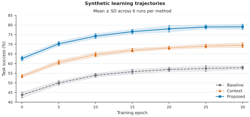
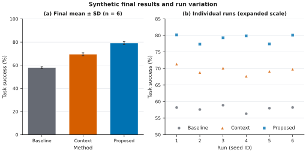

# 独立任务试用：输入、产物与实际证据

三项任务均由未继承开发过程的独立执行者完成，只提供 Skill 路径、研究任务、输入
与输出范围。任务没有给出内部参数答案。P1/P2 是 v1.0.0 发布试用，P3 是 v1.1.0
新增的图集、候选比较与主源交接试用。核心资料按相对路径保存，便于核查与再生成。

## P1：重复测量 CSV（v1.0.0）

**任务：** 使用 Skill 将给定 CSV 做成论文排版双面板图。左侧每组随时间的均值与
95%CI，右侧最后时间点的分布。subject 为独立个体、随时间重复测量；不做组间假设
检验。数据为合成演示，英文标签，宽 180 mm。交付 SVG、预览、可复现来源、审查
和图注。


[原始 CSV](evidence/pilot-data/observations.csv) · [规格](evidence/pilot-data/figure-spec.json) ·
[SVG](evidence/pilot-data/pilot-figure.svg) · [统计摘要](evidence/pilot-data/summary-statistics.csv) ·
[审查](evidence/pilot-data/review-results.json) · [冻结版比较](evidence/pilot-data/comparison.json)

执行者自行把 `time==max(time)` 明确筛选为 `final-time.csv`，没有假装绘图规格包含
尚未实现的筛选参数。八个 group×time 单元都按 n=3 计算点态 Student-t CI；最后
时间点保留 Control=[12,13,14]、Treatment=[16,17,18]。原图 180×90 mm，36 个 text、
57 个 path、0 个 image，25 种逻辑标签核对通过。

在最终源码冻结后再次复制模块、重新执行。与初版相比，八组均值/CI/n/缺失数最大
绝对差为 0；SVG、PDF、PNG 逐字节一致。最终包还在新临时目录重建，主图及两份
派生 CSV 再次逐字节一致。源码文件 hash 保存在 [SOURCE.json](evidence/pilot-data/SOURCE.json)。
这个观察只适用于本任务的有效输入，不代表版本变化对所有输入都没有影响。

主图 SVG SHA-256：

```text
2dca2ff61aee0eff4d1550d58a8197c4118acc70c86d650bc31b9278049a31c9
```

独立 [编辑副本](evidence/pilot-data/editability-test.svg) 中将 Time 改为 Time (edited)，
并改变 Control 均值曲线颜色/线宽。Inkscape 实际渲染可见变化，原稿 hash 保持不变；
没有修改代表实验数据的曲线坐标。[编辑副本审核](evidence/pilot-data/editability-audit.json)

从仓库根目录重新出图：

```bash
python skills/figurefoundry/scripts/figurefoundry.py plot --spec docs/evidence/pilot-data/figure-spec.json --out build/pilot-data
```

图注见 [CAPTION.md](evidence/pilot-data/CAPTION.md)。单位与具体期刊没有提供，因此
没有凭空补单位或宣称合规；这不是程序拒绝继续工作的理由。

## P2：实验流程与宽窄布局（v1.0.0）

**任务：** 用英文标签制作 180 mm 宽可编辑 SVG；Specimen→Preparation→Assay→
Analysis→Result，Quality control 接收 Assay 信息并在需复核时反馈 Preparation，
Reference database 向 Analysis 提供对照。再做较窄的布局变体，连接不变；交付源规格、
预览和审查，并在独立副本实际试改文字与颜色。


[主图规格](evidence/pilot-diagram/diagram-main.json) · [窄版规格](evidence/pilot-diagram/diagram-narrow.json) ·
[原始拓扑](evidence/pilot-diagram/scientific-topology.json) · [拓扑核对](evidence/pilot-diagram/topology-check.json)

主图 180×80 mm，窄版 120×94 mm；均为七节点、七条有向连接，八种完整可见标签，
没有嵌入 image。窄版折返排版没有反转科学连接。实际查看时发现数据库圆柱顶部和
文字偏近，执行者加高后重渲染，保留可读的标签与正确箭头。

[试改副本](evidence/pilot-diagram/workflow-180mm-editability-test.svg) 将 Result 改为
Output，结果椭圆从 #EEEAF7 改为 #DDEFE1。路径几何/属性不变，像素变化局限于
目标椭圆，原稿 hash 不变；[editability-test.json](evidence/pilot-diagram/editability-test.json)
保存了逐元素差异和边界。

```bash
python skills/figurefoundry/scripts/figurefoundry.py diagram --spec docs/evidence/pilot-diagram/diagram-main.json --out build/workflow.svg
python skills/figurefoundry/scripts/figurefoundry.py diagram --spec docs/evidence/pilot-diagram/diagram-narrow.json --out build/workflow-narrow.svg
```

## P3：统一风格的两张独立图与版本交接（v1.1.0）

**任务：** 从随附的 `learning.csv` 和 `endpoints.csv` 制作学习轨迹与最终结果两张
独立论文图；方法颜色、点形、线型和字号一致。为一张图比较两套版式并选择，交付
可编辑 SVG、来源、预览、图注、alt text、图集索引及可继续修改的主源。

执行者自行选择均值与样本 SD 表达运行差异，识别每个方法有六个独立 run ID，
每个 run 在七个 epoch 重复观测。学习表 126 行、终点表 18 行全部保留；末次 epoch
与终点表的 18 个值逐项匹配。[完整独立交付](evidence/pilot-v11/README.md)





| 图件 | 实际 mm | 可见 text | path | image | 最小字号 |
|---|---|---:|---:|---:|---:|
| 学习轨迹 | 180×85 | 24 | 52 | 0 | 7.5 pt |
| 最终结果与独立运行 | 180×90 | 33 | 34 | 0 | 7.5 pt |

### 候选选择与成图改善

图 2 比较了相同 180 mm 宽度的横排 180×90 与竖排 180×130，两版使用相同输入、
统计量、轴范围和角色样式。实际查看彩色、灰度、96 dpi 和放大预览后选择横排，
在保留均值比较与全部运行点的同时节省 40 mm 高度。

试用还发现初版 x 轴紧贴 0/30 导致端点符号裁切，修订为 −0.8/30.8 后保留完整
符号；独立图 2 补上点形图例，使它脱离图 1 也能辨认方法。修订通过新规格和新
输出保存。[候选和视觉判断](evidence/pilot-v11/notes/VISUAL_REVIEW.md)

### 实际数值、编辑与交接验证

- 独立标准库计算核对学习图全部 21 个均值顶点、结果图全部 18 个运行点和三根柱高。
  三个末次均值为 57.881333、69.476167、79.047500%，样本 SD 为 0.866006、
  1.252156、1.307871 个百分点。
- 在实际 SVG 副本中修改 `<text>` 标题和原生背景形状填色，并使用 Inkscape 重渲染。
  正式主稿 SHA-256 不变。
- 未列入允许范围的标题改动返回 exit 2；指定对应 text ID 后返回 exit 0；移动一个
  数据点的 y 坐标返回 exit 2。正式精修只改文字/辅助网格颜色，`revision` 通过。
- `project` 先以 JSON 源建立共享样式基线，再将实际精修 SVG 登记为选中主源，
  继承上游源哈希并再次校验冻结基线。图注、alt 和图集索引随所选版本一起生成。
- 独立重建后，两张 SVG 与 PNG 均逐字节相同。PDF 的文件哈希因创建时间不同而
  改变；实际解压比较的页面内容、资源和其他元数据相同。

[数值与真实图元核验](evidence/pilot-v11/qa/independent-data-check.json) ·
[编辑正反例](evidence/pilot-v11/qa/editability-and-guard-report.json) ·
[重建与物理尺寸](evidence/pilot-v11/qa/reproduction-and-size-report.json) ·
[PDF 对象比较](evidence/pilot-v11/qa/pdf-metadata-comparison.json) ·
[图集最终索引](evidence/pilot-v11/reports/project-index.json)

从仓库根目录可用保留的运行时和输入重建：

```bash
python docs/evidence/pilot-v11/reproduce.py --outdir qa/rebuild-next
```

`--outdir` 相对该试用目录；使用新的目录名保存每次结果。当前可编辑 SVG、候选、
输入表和被冻结的源之间的对应关系见 [交接说明](evidence/pilot-v11/notes/SOURCE_HANDOVER.md)。

## 图元试改与成图核验方式

三项都用 Inkscape 渲染真实 SVG，查看全图、名义尺寸和灰度视图。测试覆盖的是
**修改原生 XML 对象后重新渲染**，没有声称测试过所有图形编辑器的 GUI 操作。
英文使用本机已有字体；Arial 在本环境回退到 Nimbus Sans，文字没有转成轮廓。
只读缓存产生的警告与可见图件核查分开记录，未修改系统受保护目录。

这些证据补充自动测试，不能代替审稿人、实验记录、领域模型或目标期刊的当前要求。
