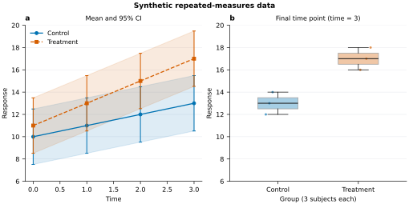
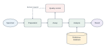
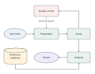

# 独立任务试用：输入、产物与实际证据

两名独立执行者未继承开发过程，仅获得当前 Skill 路径、任务、输入路径与输出范围。
任务没有提供内部参数答案或暗示已知 bug。随后核对其产物，并对最终冻结代码重新
运行 P1。核心试用资料按相对路径保存在本目录，便于核查和再生成。

## P1：重复测量 CSV

**任务：** 使用 Skill 将给定 CSV 做成论文排版双面板图。左侧每组随时间的均值与
95%CI，右侧最后时间点的分布。subject 为独立个体、随时间重复测量；不做组间假设
检验。数据为合成演示，英文标签，宽 180 mm。交付 SVG、预览、可复现来源、审查
和图注。



[原始 CSV](evidence/pilot-data/observations.csv) · [规格](evidence/pilot-data/figure-spec.json) ·
[SVG](evidence/pilot-data/pilot-figure.svg) · [统计摘要](evidence/pilot-data/summary-statistics.csv) ·
[审查](evidence/pilot-data/review-results.json) · [冻结版比较](evidence/pilot-data/comparison.json)

执行者自行把 `time==max(time)` 明确筛选为 `final-time.csv`，没有假装绘图规格包含
尚未实现的筛选参数。八个 group×time 单元都按 n=3 计算点态 Student-t CI；最后
时间点保留 Control=[12,13,14]、Treatment=[16,17,18]。原图 180×90 mm，36 个 text、
57 个 path、0 个 image，25 种逻辑标签核对通过。

在最终源码冻结后再次复制模块、重新执行。与初版相比，八组均值/CI/n/缺失数最大
绝对差为 0；SVG、PDF、PNG 逐字节一致。最终包还在新临时目录重建，主图及两份
派生 CSV 再次逐字节一致。源码文件 hash 保存在 [SOURCE.json](evidence/pilot-data/SOURCE.json)。
这个观察只适用于本任务的有效输入，不代表版本变化对所有输入都没有影响。

主图 SVG SHA-256：

```text
2dca2ff61aee0eff4d1550d58a8197c4118acc70c86d650bc31b9278049a31c9
```

独立 [编辑副本](evidence/pilot-data/editability-test.svg) 中将 Time 改为 Time (edited)，
并改变 Control 均值曲线颜色/线宽。Inkscape 实际渲染可见变化，原稿 hash 保持不变；
没有修改代表实验数据的曲线坐标。[编辑副本审核](evidence/pilot-data/editability-audit.json)

从仓库根目录重新出图：

```bash
python skills/figurefoundry/scripts/figurefoundry.py plot --spec docs/evidence/pilot-data/figure-spec.json --out build/pilot-data
```

图注见 [CAPTION.md](evidence/pilot-data/CAPTION.md)。单位与具体期刊没有提供，因此
没有凭空补单位或宣称合规；这不是程序拒绝继续工作的理由。

## P2：实验流程与宽窄布局

**任务：** 用英文标签制作 180 mm 宽可编辑 SVG；Specimen→Preparation→Assay→
Analysis→Result，Quality control 接收 Assay 信息并在需复核时反馈 Preparation，
Reference database 向 Analysis 提供对照。再做较窄的布局变体，连接不变；交付源规格、
预览和审查，并在独立副本实际试改文字与颜色。





[主图规格](evidence/pilot-diagram/diagram-main.json) · [窄版规格](evidence/pilot-diagram/diagram-narrow.json) ·
[原始拓扑](evidence/pilot-diagram/scientific-topology.json) · [拓扑核对](evidence/pilot-diagram/topology-check.json)

主图 180×80 mm，窄版 120×94 mm；均为七节点、七条有向连接，八种完整可见标签，
没有嵌入 image。窄版折返排版没有反转科学连接。实际查看时发现数据库圆柱顶部和
文字偏近，执行者加高后重渲染，保留可读的标签与正确箭头。

[试改副本](evidence/pilot-diagram/workflow-180mm-editability-test.svg) 将 Result 改为
Output，结果椭圆从 #EEEAF7 改为 #DDEFE1。路径几何/属性不变，像素变化局限于
目标椭圆，原稿 hash 不变；[editability-test.json](evidence/pilot-diagram/editability-test.json)
保存了逐元素差异和边界。

```bash
python skills/figurefoundry/scripts/figurefoundry.py diagram --spec docs/evidence/pilot-diagram/diagram-main.json --out build/workflow.svg
python skills/figurefoundry/scripts/figurefoundry.py diagram --spec docs/evidence/pilot-diagram/diagram-narrow.json --out build/workflow-narrow.svg
```

## 实际验证的范围

两项都用 Inkscape 渲染真实 SVG，查看全图、名义尺寸和灰度视图。测试覆盖的是
**修改原生 XML 对象后重新渲染**，没有声称测试过所有图形编辑器的 GUI 操作。
英文使用本机已有字体；Arial 在本环境回退到 Nimbus Sans，文字没有转成轮廓。
只读缓存产生的警告与可见图件核查分开记录，未修改系统受保护目录。

这些证据补充自动测试，不能代替审稿人、实验记录、领域模型或目标期刊的当前要求。
