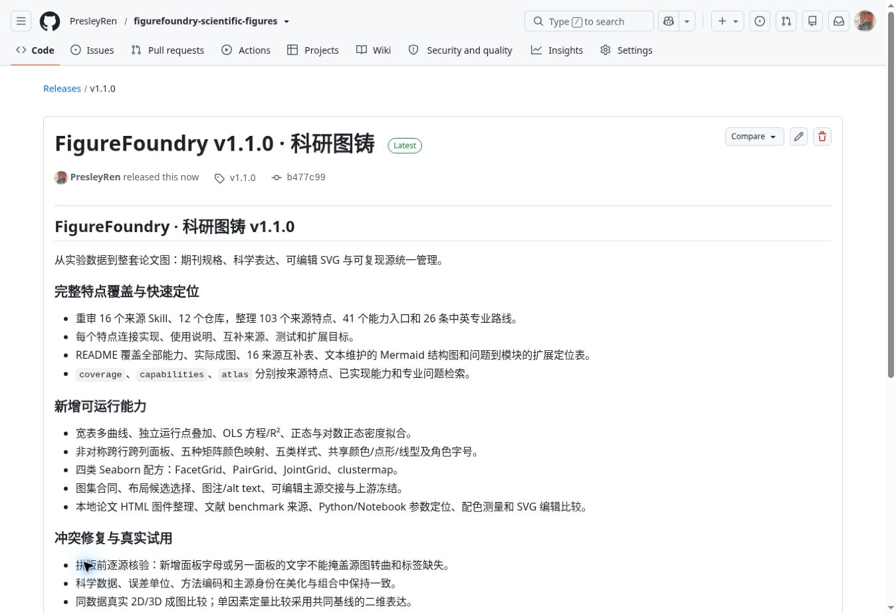
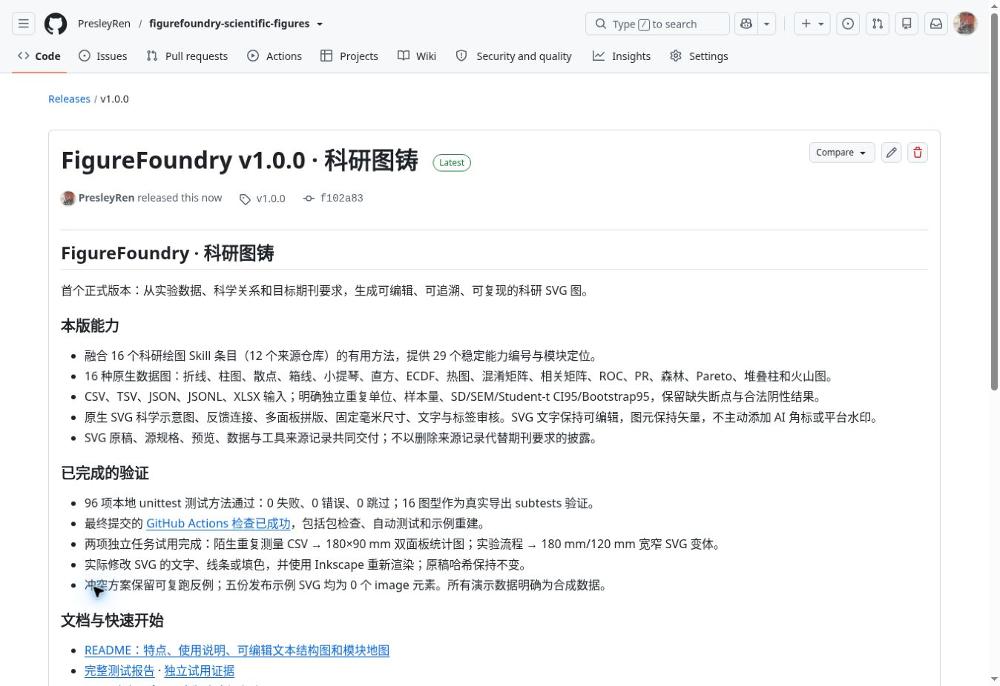

# 发布记录

## v1.1.0 · 完整特点覆盖与图集工作流

**FigureFoundry v1.1.0 · 科研图铸已于 2026-10-20 08:39:37 UTC 正式发布。**

- [正式 Release](https://github.com/PresleyRen/figurefoundry-scientific-figures/releases/tag/v1.1.0)
- [发布提交 b477c99](https://github.com/PresleyRen/figurefoundry-scientific-figures/commit/b477c99bdd1f7ac8e99d18a264a8ea3bc586b1e1)
- [发布提交的 GitHub Actions 成功记录](https://github.com/PresleyRen/figurefoundry-scientific-figures/actions/runs/39394632443)
- [发布元数据、标签和 CI 验证](evidence/publication/release-v1.1.0.json)

本版包含 **16 个来源 Skill、103 个来源特点、41 个能力入口和 26 条专业路线**，
**190 项自动测试方法全部通过**；独立图集试用、成图审阅和整个 Skill 文件夹的
独立调用记录随版本保存。README 包含全部能力说明、来源互补表、文本维护的
Mermaid 结构图及问题到模块的扩展指南。

`v1.1.0` 指向已经通过 CI 的提交 `b477c99bdd1f7ac8e99d18a264a8ea3bc586b1e1`。
Release 为正式版本，`draft=false`、`prerelease=false`。303 个文件的远程 Git 树
与本地通过验证的发布文件树一致：

```text
0fd01debb653b6fe05a633547a1363041170778b
```

CI 的依赖安装、包索引/文档链接验证、行为回归、合成示例重建及四类 Seaborn 配方
全部成功。详细方法与独立试用见 [TEST_REPORT.md](TEST_REPORT.md) 和
[FORWARD_TESTS.md](FORWARD_TESTS.md)。



这份发布凭证在 Release 完成后追加到主分支。发布标签继续保留已经验证的代码、
数据、示例和文档版本。

## v1.0.0 · 首次发布

**FigureFoundry v1.0.0 · 科研图铸已于 2026-10-20 06:09:31 UTC 正式发布。**

- [正式 Release](https://github.com/PresleyRen/figurefoundry-scientific-figures/releases/tag/v1.0.0)
- [发布提交 f102a83](https://github.com/PresleyRen/figurefoundry-scientific-figures/commit/f102a83bba7713b4386e67d62425df23f446c0b8)
- [该提交的 GitHub Actions 成功记录](https://github.com/PresleyRen/figurefoundry-scientific-figures/actions/runs/39378559130)
- [发布元数据与检查结果](evidence/publication/release.json)

Release 不是草稿，也没有标记为预发布。`v1.0.0` 指向上述提交；该版本共 101 个
文件，远程 Git 树与本地完成验证的文件树完全一致，树 SHA 为
`c85733ad9212044c481bc4e5e0ec68678370ff73`。

GitHub CI 的依赖安装、包检查、数值/导出/SVG/示意图/CLI 测试、合成示例重建全部
成功。本地 96 项测试与两项独立任务试用的具体证据见 [测试报告](TEST_REPORT.md)
及 [独立试用](FORWARD_TESTS.md)。



这份记录在发布完成后加入主分支，用于保存发布凭证。没有移动或重写 `v1.0.0` 标签，
也没有借此修改已发布版本的绘图引擎、测试或示例数据。
