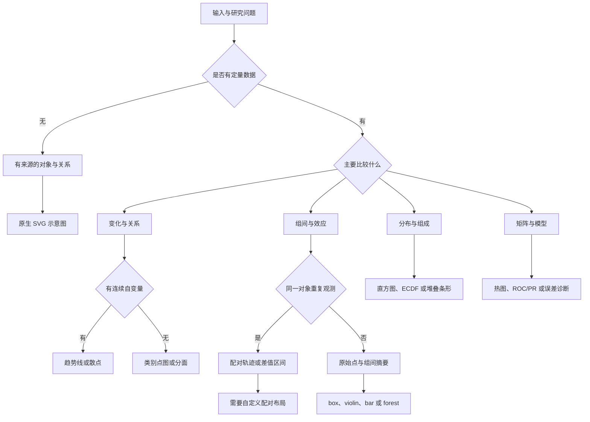

# 从实验问题选择图型

先确定观察单位和要比较的量，再选图型。保持一个主问题和清楚的面板分工；版式、颜色和拟合服务于数据，不要求结果显著才能成图。

**当前原生图型**为 line、bar、scatter、box、violin、hist、ecdf、heatmap、confusion、roc、pr、forest、pareto、stacked_bar、volcano、correlation。它们共用数据、样式、SVG 导出和审核流程。下方更广的专业图谱是知识与扩展路由，不代表额外图型已成为内置命令。实际测试范围以仓库 docs/TEST_REPORT.md 为准。

## 1. 选图决策图

这段 Mermaid 同时是可阅读的文本图源，新增分支时保留科学问题与图型的关系。



## 2. 原生图型：输入与解释

| kind | 适合的问题 | 必须核对的含义 |
|---|---|---|
| line | 时间、剂量、频率、位移等有序自变量的趋势；可多组比较 | x 顺序、单位、缺失断口；连接是否有意义；重复值的汇总单位 |
| scatter | 两个量的关系、预测与实测、样本差异 | 轴单位、配对样本、异常值来源；显式 fit=ols 才拟合。相关或拟合线不自动构成因果证据 |
| bar | 可解释的组摘要、计数、预先规定的比较 | 零基线、中心/误差定义、独立 n；原始点能帮助辨别不同分布 |
| box | 各组位置与分散程度 | 中位数、四分位数、须线规则和离群点；箱线图的离群点标记不是删除理由 |
| violin | 多组分布形状 | 样本量、密度估计/带宽、取值边界；小样本时原始点/箱线往往更稳妥 |
| hist | 一组或多组数值的分布 | 分箱边界、计数或密度、组间是否相同 bins、不同样本量 |
| ecdf | 比较完整经验分布，读取分位数或尾部 | 累积分母、重复值、方向；没有带宽选择但仍需要标明 n |
| heatmap | 数值矩阵、实验条件 × 测量变量 | 轴顺序、缺失颜色、色标范围、单位、是否逐行归一化；纯 SVG 网格与色条 |
| confusion | 分类正确与错误来自哪里 | 行/列含义、类别顺序、原始计数或归一化；不得交换真值和预测方向 |
| roc | 分类阈值改变时 TPR 与 FPR 的关系 | 正类、评价集合、阈值来源、AUC 的计算/提供方式；接近随机的结果照常绘制 |
| pr | 精确率与召回率的取舍 | 正类和患病率/类别比例、测试集构成；不同抽样比例的 PR 不可未经说明直接比较 |
| forest | 多个已估计效应及其区间 | 估计量、区间方法、比较参考；比值型效应的参考值常是 1，差值型常是 0 |
| pareto | 两个性能/成本目标的权衡 | 每个目标越大还是越好、单位、可比实验条件；前沿不是单一“冠军”的证据 |
| stacked_bar | 可相加类别的组成或总量 | 总计、分母、缺失类别、顺序；百分比与绝对数量不混用 |
| volcano | 效应大小与差异检验结果的联合分布 | 横轴效应定义、纵轴 p 或校正值及变换、标签筛选规则；不能要求最少显著点数量 |
| correlation | 多变量相关结构 | Pearson/Spearman 或上游已算矩阵、缺失处理、样本数、颜色范围；低相关也是合法输入 |

统计输入应遵循 [scientific-integrity.md](scientific-integrity.md)。配置字段、允许的误差类型和各图型必需列以 CLI 帮助和已运行示例为准；本表不会凭图型名称扩大统计引擎能力。

## 3. 进一步的专业图谱与扩展入口

| 问题 / 图型家族 | 保留的能力方向 | 推荐入口与边界 |
|---|---|---|
| 配对前后、重复测量、superplot | 展示每个独立单位，配对差值与整体变化 | 自定义 Matplotlib 布局；从 subject/run ID 构造连线，不能按行号随意配对 |
| 回归残差、预测-实测、Bland–Altman | 从“关系好看”进一步看偏差、校准和误差结构 | scatter/line 基础上扩展；一致性界限、异方差和重复观测方法由分析提供 |
| PCA、RDA、UMAP、t-SNE | 投影、载荷、组间结构 | 上游分析输出坐标再绘制；R 生态可选。轴解释度、标准化和算法种子不能编造，聚团不等于显著差异 |
| 富集点图、GSEA、MA、Manhattan、QQ | 组学效应、排序、富集和多重比较 | 自定义 Python 或既有 R 分析栈；保存基因集版本、检验宇宙、校正方法和分析结果 |
| 复杂聚类热图、OncoPrint、注释轨道 | 矩阵与元数据联动 | R/ComplexHeatmap 或自定义矢量网格；聚类距离/方法和行列顺序需可追溯 |
| 生存曲线与风险表 | 时间结局、删失和风险人数 | 已有生存分析结果或专业包；记录删失、终点和各时间点人数，不用普通折线假造 KM 估计 |
| Mantel、距离矩阵联系 | 生态/空间矩阵关联 | R 或上游分析；置换单位与距离定义由分析决定，不由颜色或箭头推断 |
| UpSet、集合交集 | 多集合重叠的精确计数 | 专用库或自定义点阵/条形，核对计数一致性；复杂交集通常比多圈 Venn 更易读 |
| 桑基、alluvial、chord、网络图 | 流量、类别迁移或连接关系 | 自定义原生 SVG 或专业后端；记录边类型/权重，流量守恒仅在适用时检查，拓扑不能靠美化新增 |
| KDE、山脊、雨云、边际分布 | 多组形状、位置和样本点 | Seaborn/ggplot2 或自定义；说明带宽、归一化和样本量，避免把稀疏数据画成精确密度 |
| 剂量响应、动力学、频响、相图、Poincaré、分岔 | 物理或工程系统变化规律 | line/scatter 基础或科学计算专用输出；记录采样、滤波、单位及稳态/瞬态定义 |
| 场、等高线、矢量流、响应面 | 空间标量/方向、二维参数响应 | 优先非栅格化 mesh/contour/quiver；真实三维问题需适当视图，不能用立体柱代替容易读的二维比较 |
| 电路、受力、几何、分子结构 | 专业符号和几何约束 | TikZ/circuitikz/专业工具可选；先验证实际 SVG 文本与图元，再声明符合本项目交付 |
| 机制、架构、流程、图形摘要 | 对象、关系、实验步骤或控制逻辑 | [diagram-design.md](diagram-design.md)；节点与边来自明确来源，示意图不伪装成测量数据 |

上表的广度来自相关 Skill 的方法汇总，具体映射见仓库 docs/SOURCES.md。它不是“所有专业分析都内置”的承诺；专业统计先在相应分析环境正确完成，再进入统一制图和审核。

## 4. 几种常见取舍

**组比较。** 如果样本不多，优先展示原始点与适当摘要；相同均值可能对应完全不同分布。配对数据明确连接同一单位。bar 适合计数/总量或有清楚摘要目的的任务，不应只为突出平均差异隐藏分布。

**密集点云。** 先考虑透明度、标记尺寸和分面；需要分箱/密度时记录方法。严格 SVG 不自动 rasterize，也不静默降采样。对象太多导致文件难以编辑时，报告规模并选择有科学含义的汇总表示，保留全量数据。

**颜色。** 无序类别用离散色；从低到高的量用顺序色；有有意义中心（如零）的偏差可用发散色。多个面板表示同一种量时使用共同色标和图例。色盲友好调色板仍要配合线型/形状和实际成图检查。

**多指标。** 单位、范围和优化方向不同的量通常用对齐的多个面板。双 y 轴、雷达和装饰性三维需要明确理由及读取任务，不能只因为“更高级”采用。复杂结构的立体示意与定量图的三维编码分别判断。

## 5. 查找与扩展

在仓库根目录运行：

```bash
python skills/figurefoundry/scripts/figurefoundry.py capabilities --query heatmap
python skills/figurefoundry/scripts/figurefoundry.py plot --spec examples/benchmark.json --out examples/outputs/benchmark
```

新增图型先写：输入列/矩阵的定义、输出对应关系、数据和缺失规则、阴性/极端输入、图注模板、原生 SVG 表示。随后接入公共导出/审核并添加有意义的测试，最后更新能力索引和本表。不要先复制一张复杂图库预览，再为其补造实验含义。
